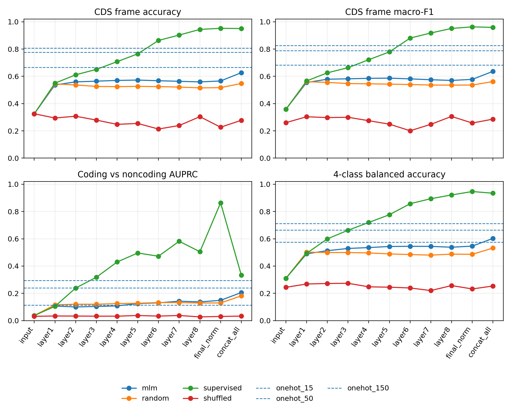
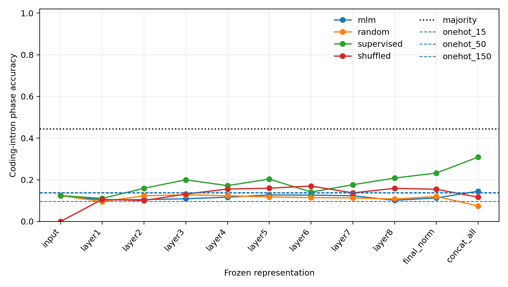
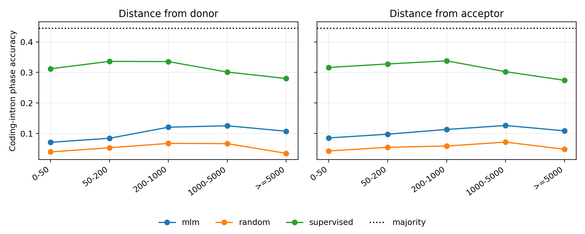
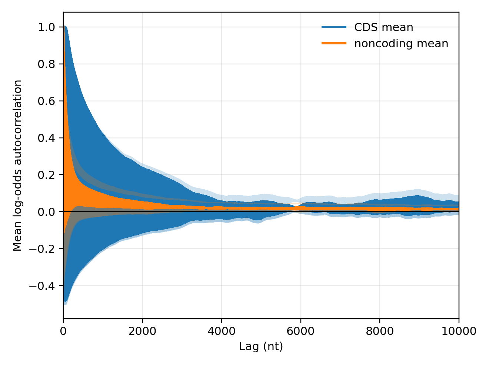
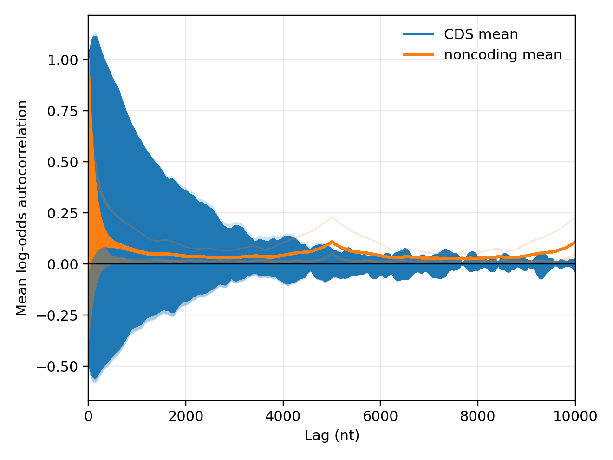

# Frozen-backbone belief-state probes

This directory contains Experiments A, B, and E from the belief-state probing
brief. Phase 2 experiments C and D were not run.

## Setup and data split

- Window geometry was verified before the full run: 10,000 bp windows, 5,000 bp
  stride, no per-chromosome cap, and the transcript-oriented central 5,000 bp
  (`[2500, 7500)`) used for sampling.
- Probe train chromosomes were 2, 3, 4, 6, 7, 8, 11--21, X, and Y.
- Weight decay was selected only on chromosomes 5, 9, and 10 from
  `{1e-4, 1e-3, 1e-2}`. Chr22 was the clean evaluation set and chr1 was the
  second test set.
- No windows were regenerated. The 22,895 existing chr2 windows under `val/`
  were indexed as probe-training windows. The manifest has 195,072 files in
  `train/`, 68,555 in `val/`, and 26,252 in `test/`.
- The Human MLM checkpoint contains `backbone_state_dict`, used every primary
  chromosome except chr22 during pretraining, and uses the existing five-token
  transfer path that removes the MLM MASK embedding.
- Minus-strand sequence and label arrays are reverse-complemented/reversed into
  transcript orientation in the existing windows.
- All CDS phase validity decisions use `reference_phase_mask`. Unknown (`-1`)
  and conflicting (`-2`) phase positions are excluded.
- Audit exception: despite the requested conceptual split, the supervised
  checkpoint's actual manifest and log show that chr2 was in validation, not in
  its 195,072-window training set. The probes still use chr2 for probe training.

The complete machine-readable audit is in
[`assumption_check.json`](assumption_check.json). Every experiment directory
contains its run configuration, chromosome lists, sampled window/position
counts, checkpoint hashes, and seeds.

## Experiment A: four-state frozen probes

The linear probe predicts noncoding or CDS frame 0/1/2 from frozen features.
Training used 2,000,000 class-balanced positions; tuning used 500,000 positions;
chr22 and chr1 each used 2,000,000 positions at natural class frequencies.

The table reports representative frozen readouts. Weight decay was selected on
chr5/9/10 separately for each readout. Values are fractions, not percentages.

| Evaluation | Features | Layer | 4-class balanced accuracy | Coding AUPRC | CDS frame accuracy | CDS frame macro-F1 |
|---|---|---:|---:|---:|---:|---:|
| chr22 | MLM | final norm | 0.5463 | 0.1487 | 0.5660 | 0.5777 |
| chr22 | MLM | concat all | 0.6030 | 0.2058 | 0.6268 | 0.6367 |
| chr22 | Random | concat all | 0.5325 | 0.1813 | 0.5478 | 0.5618 |
| chr22 | One-hot | +/-150 bp | 0.7119 | 0.2940 | 0.8078 | 0.8259 |
| chr22 | Supervised | final norm | **0.9468** | **0.8643** | **0.9525** | **0.9630** |
| chr22 | Shuffled labels | concat all | 0.2536 | 0.0330 | 0.2777 | 0.2861 |
| chr1 | MLM | final norm | 0.5227 | 0.1218 | 0.4975 | 0.5251 |
| chr1 | MLM | concat all | 0.5807 | 0.1707 | 0.5653 | 0.5876 |
| chr1 | Random | concat all | 0.5046 | 0.1576 | 0.4862 | 0.5082 |
| chr1 | One-hot | +/-150 bp | 0.7084 | 0.2829 | 0.7579 | 0.8036 |
| chr1 | Supervised | final norm | **0.9522** | **0.9327** | **0.9505** | **0.9625** |
| chr1 | Shuffled labels | concat all | 0.2609 | 0.0296 | 0.2916 | 0.3006 |

The MLM residual stream contains linearly decodable frame information: on clean
chr22, concatenating all layers raises frame accuracy from 56.6% at the final
normalization to 62.7%, versus 54.8% for concatenated random features. However,
the +/-150 bp one-hot control reaches 80.8%, so the result does not support the
strong form of the prediction that MLM learns frame substantially beyond local
sequence composition. The supervised backbone is the clear upper reference.

Full per-layer results, including NLL and 15-bin ECE, are in
[`A_frame/metrics.tsv`](A_frame/metrics.tsv).

## Experiment B: coding-intron phase

Coding introns are introns between consecutive CDS segments in a transcript.
Their phase is the transcript-oriented frame at which the downstream CDS resumes:
`(3 - downstream GTF phase) % 3` on both genomic strands. Transcript conflicts are
`-2`; positions outside coding introns are `-1`. Real-window checks matched the
existing `reference_phase_labels` at 618/618 plus-strand and 664/664 minus-strand
acceptors.

The seven classes are noncoding, CDS frame 0/1/2, and coding-intron phase 0/1/2.
Training used 2,000,000 positions balanced across the seven classes. Tuning used
500,000 natural-frequency positions; chr22 and chr1 each used 2,000,000.

| Evaluation | Features | Layer | 7-class balanced accuracy | Intron phase accuracy | Intron majority baseline |
|---|---|---:|---:|---:|---:|
| chr22 | MLM | final norm | 0.3281 | 0.1132 | 0.4451 |
| chr22 | MLM | concat all | 0.3679 | 0.1453 | 0.4451 |
| chr22 | Random | concat all | 0.3198 | 0.0747 | 0.4451 |
| chr22 | One-hot | +/-150 bp | 0.4335 | 0.1389 | 0.4451 |
| chr22 | Supervised | final norm | **0.5817** | 0.2326 | 0.4451 |
| chr22 | Supervised | concat all | 0.5607 | **0.3089** | 0.4451 |
| chr1 | MLM | final norm | 0.3096 | 0.1678 | 0.4461 |
| chr1 | MLM | concat all | 0.3429 | 0.1849 | 0.4461 |
| chr1 | Random | concat all | 0.3046 | 0.0984 | 0.4461 |
| chr1 | One-hot | +/-150 bp | 0.4232 | 0.1906 | 0.4461 |
| chr1 | Supervised | final norm | **0.5804** | 0.2587 | 0.4461 |
| chr1 | Supervised | concat all | 0.5634 | **0.3085** | 0.4461 |

Concatenating MLM layers improves over its final layer, but intron-phase accuracy
remains far below the natural-frequency majority baseline on both held-out
chromosomes. Even the supervised backbone remains below that baseline. Therefore
the proposed strong, linearly decodable intron belief state is **not supported**
by this experiment. Distance-binned counts and donor/acceptor results are in
[`B_intron_phase/distance_binned_metrics.tsv`](B_intron_phase/distance_binned_metrics.tsv);
all layer-level metrics are in
[`B_intron_phase/metrics.tsv`](B_intron_phase/metrics.tsv).

## Experiment E: evidence overcounting and coding bias

Autocorrelation was computed from raw per-base log odds. Because the three frame
tracks have a strong period-three component, the interpretable summary uses
codon-stride autocorrelation.

| Dataset | Region | Mean codon-stride IAT | IAT in nucleotides | E-fold distance |
|---|---|---:|---:|---:|
| Drosophila chrX+ | CDS | 922.9 codons | 2,768.6 nt | 1,176 nt |
| Drosophila chrX+ | noncoding | 293.6 codons | 880.7 nt | 149 nt |
| Human chr1+ | CDS | 1,277.9 codons | 3,833.6 nt | 1,909 nt |
| Human chr1+ | noncoding | 405.2 codons | 1,215.6 nt | 167 nt |

The kilobase-scale correlation supports the premise that UniAnn receives many
correlated per-base emissions rather than independent observations. It is
consistent with a large softening temperature, although the IAT cannot be
identified numerically with temperature `T`.

The validation coding fraction was 0.1485, giving
`log(prior_noncoding/prior_coding) = 1.7462`. The strict-locus grid used joint
softmax `T=9` and tested both signs through the full prior magnitude.

| Coding bias | UniAnn Sn | UniAnn Pr | UniAnn F1 | EviAnn+UniAnn Sn | EviAnn+UniAnn Pr | EviAnn+UniAnn F1 |
|---:|---:|---:|---:|---:|---:|---:|
| -1.7462 | 53.6 | 69.7 | 60.60 | 87.9 | 90.3 | 89.08 |
| 0.0000 | 77.9 | 79.9 | 78.89 | 90.7 | 90.1 | 90.40 |
| 0.4365 | 79.9 | 80.6 | 80.25 | 91.0 | 90.1 | **90.55** |
| 0.8731 | 80.9 | 80.6 | **80.75** | 91.2 | 89.9 | 90.55 |
| 1.7462 | 80.7 | 80.1 | 80.40 | 91.2 | 89.6 | 90.39 |

Bias helps UniAnn alone, but the best EviAnn+UniAnn improvement over zero bias is
only 0.15 F1 points. Applying the full validation prior is not optimal, so class
prior mismatch alone does not explain why `T` around 7--9 works. Full results are
in [`E_overcounting/extended_coding_bias_grid.tsv`](E_overcounting/extended_coding_bias_grid.tsv).

## Runtime, storage, and validation

| Run | Approximate wall time | Feature artifact size |
|---|---:|---:|
| A | 1 h 14 min | 91 GB |
| B | 49 min | 91 GB |
| E | 42 min initial full grid; 20 s cached verification | compact only |

Feature extraction used batches of four windows and float16 feature storage.
Observed GPU allocation during B feature extraction was approximately 1.5 GiB;
peak memory was not instrumented, so this is not presented as a measured peak.
The frozen-backbone hook/parameter test and the hand-built plus/minus/conflict
intron-label test both pass (`2/2`, including CUDA).

## Overall conclusion

The results partially support the belief-state hypothesis for CDS frame: MLM
features are decodable and information is distributed across layers, but a local
one-hot control is substantially stronger. Coding status is also decodable, with
the supervised representation much stronger than MLM. The defining prediction
for coding-intron phase is not supported: concatenation helps, but no tested
backbone exceeds the phase-majority baseline. Experiment E provides direct
evidence of long-range correlation and hence emission overcounting, while showing
that a simple class-prior bias is not an adequate replacement for temperature
softening.
